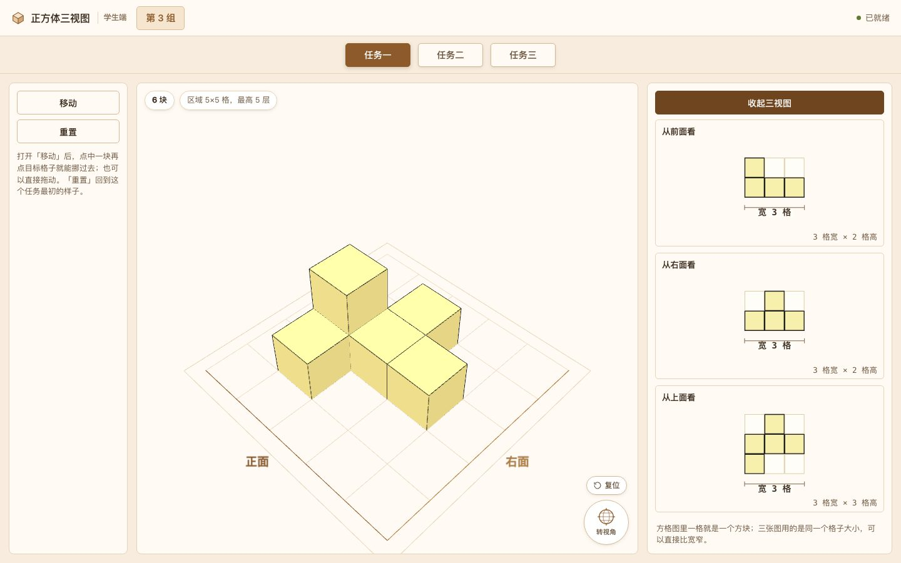
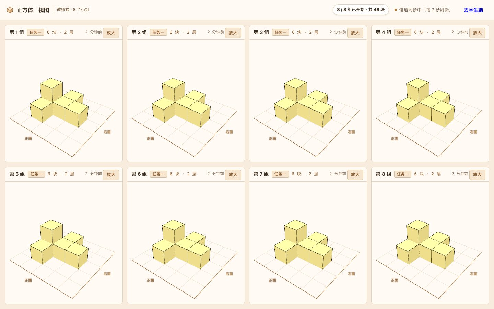
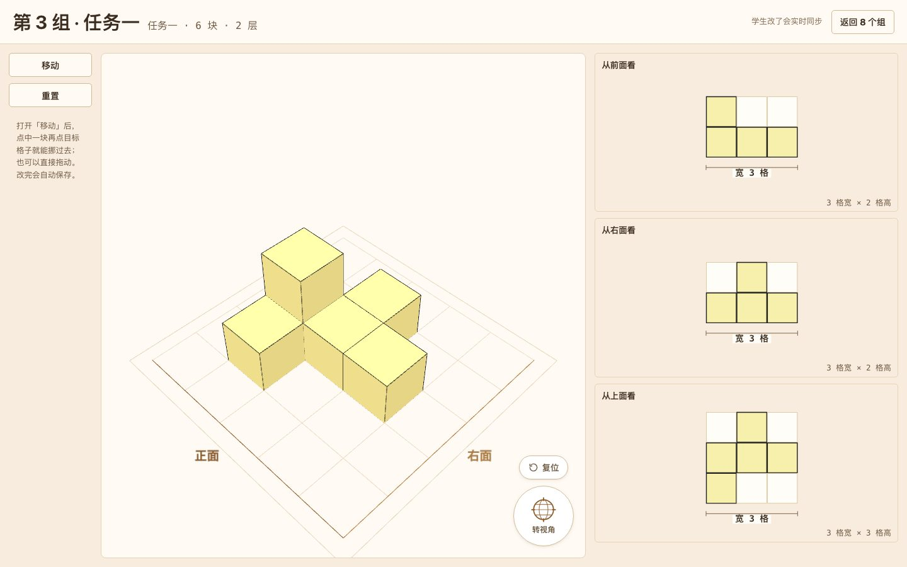

# 正方体三视图 · 课堂教具（cube-math）

学生在 5×5 的格子上摆正方体，点一下就能看到**从前面看 / 从右面看 / 从上面看**的方格图；
老师在另一台设备上**一屏同时看到 10 个小组**，还能放大某一组直接演示、修改。

- 三个课堂任务：**任务一 移动 / 任务二 拿走 / 任务三 添上**；任务一/二共用同一初始图形，任务三图形不同，三个任务的进度各自保存。
- 学生端不用账号密码，点组号就进；教师端 10 宫格实时同步（局域网 SSE 秒级，Vercel 轮询 2 秒）。
- 黄色木块 + 细黑边，点中的变粉；三视图同款配色。平板 / 一体机 / 大屏都做了触屏适配。
- **零运行时依赖**：服务器只用 Node 内置模块，three.js 已放在 [public/vendor/](public/vendor/)，断网也能开。

线上：<https://cube.dididigu.com/>（备用 <https://cube-views.vercel.app/>）
仓库：`git@github.com:tesths/cube-math.git`







> 本文件是"换电脑继续开发"的入口，以 README 和实际代码为准；
> [REQUIREMENTS.md](REQUIREMENTS.md) / [DESIGN.md](DESIGN.md) / [DEPLOY.md](DEPLOY.md) / [PRODUCT.md](PRODUCT.md)
> 是开发过程里的需求、视觉与部署记录，个别早期描述可能已被后续迭代覆盖。

---

## 0. 换电脑后怎么开始

需要 **Node.js 18 以上**（开发时用 v24）。

```bash
git clone git@github.com:tesths/cube-math.git
cd cube-math
npm install                 # 开发/测试依赖：three、playwright-core
npm start                   # 启动本地服务器
```

然后打开：

| 用途 | 地址 |
|---|---|
| 学生端 | <http://localhost:5173/> |
| 教师端 | <http://localhost:5173/teacher> |
| 健康检查 | <http://localhost:5173/healthz> |

`npm install` 只是为了重新生成本地 three.js 和跑浏览器测试；**服务器本身不需要任何 npm 包**，
只装了 Node 也能直接 `node server.js` 运行。

启动后终端会同时打印局域网地址（例如 `http://192.168.1.100:5173/`）：
老师机打开"局域网 教师端"投屏，学生机打开"局域网 学生端"各自选组，必须在同一个 Wi-Fi。

常用环境变量（完整示例见 [.env.example](.env.example)）：

| 变量 | 默认值 | 说明 |
|---|---|---|
| `PORT` | `5173` | 端口 |
| `HOST` | `0.0.0.0` | 监听地址；只想本机访问填 `127.0.0.1` |
| `DATA_DIR` | `./data` | 本地数据目录，Railway 挂 Volume 时填 `/data` |
| `CORS_ORIGIN` | `*` | 前后端分开部署时允许的来源 |

本地数据写在 `data/state.json`（自动生成，**不进 Git**）。停止服务按 `Ctrl+C`，数据会自动落盘。

---

## 1. 课堂怎么用

### 学生端

1. 首页点自己的组号（第 1~10 组）。选好后地址栏带上 `?group=N`，刷新、重开浏览器还是这一组；界面里**没有"换组"入口**，避免误点别人的组。
2. 老师换组：把地址栏改成 `?group=6` 回车即可；`?reset` 回首页；`/?reset&group=5` 一步换组。
3. 顶栏下面单独一行是**任务一 / 任务二 / 任务三**，点一下切换，默认打开是**任务一**。
4. 左侧只有一个**动作按钮**（文案随任务变：移动 / 拿走 / 添上）和**重置**：
   - **移动**：点中一块（变粉）→ 目标格出现半透明空心预览 → 点下去就挪过去；也能直接拖动。点别的方块会**叠到它上面**，不会掉到地上。
   - **拿走**：点任意方块就移走，上面的方块自动落下。
   - **添上**：点方块顶面或空格子加一块。
   - **重置**：回到当前任务的初始摆放。
5. 右侧 **看三视图**：一次同时出现"从前面看 / 从右面看 / 从上面看"三张方格图，再点一次收起。三张图共用同一个格子大小，可以直接比宽窄。
6. 舞台右下角**视角球**只负责转视角，旁边**复位**按钮负责回正；不做缩放，相机会按内容高度自动取景。
   默认视角仰角 45°（地面与水平线呈 45° / 135°），转动范围被限制在"正面 ↔ 右面"水平 90°、"默认仰角 ↔ 俯视"上下范围内，不会转到背面或钻到地面以下。
7. 键盘：`Tab` 到舞台，方向键选格；移动按 `Enter` 挪选中块、添上按 `Enter` 加一块、拿走按 `Delete` 拿走一列最上面一块；`Esc` 退出当前工具。
8. 改动**自动保存**（右上角显示"正在保存… / 已保存 14:03:12"），刷新、关浏览器再开都在；三个任务的进度**各自独立保存**，切走再切回来不会丢。

### 教师端

- `/teacher`：5 列 × 2 行 10 张卡片，显示组号、任务标签、块数 / 层数、最后改动时间；学生改完会自动更新。
- 点 **放大**：全屏演示，左边大 3D + 工具栏，右边三视图；老师**可以直接在学生作品上改**，改完自动保存回这一组，学生端 1~3 秒内跟着变；`Esc` 或"返回 10 个组"退出。

---

## 2. 三个任务与图形

坐标是整数 `[x, y, z]`，范围 `0..4`；`y` 是层数（0 = 地面），`z` 越大越靠近"正面"。
图形都放在**中间的 3×3**里（x、z 都是 `1..3`）。下面矩阵的行按**从最前面到后面**读，每行从左到右。

### 任务一 / 任务二（初始 6 块）

```
第一层              第二层
1 0 0               0 0 0
1 1 1               1 0 0
0 1 0               0 0 0
```

对应坐标（定义在 [public/js/shared/model.js](public/js/shared/model.js) 的 `FIGURE_A` / `taskInitial()`）：

```js
[[1,0,3],[1,0,2],[2,0,2],[3,0,2],[2,0,1],[1,1,2]]
```

- **任务一 = 移动**：6 块固定，只能挪位置，数量不变。
- **任务二 = 拿走**：同样 6 块，点谁拿走谁；可以拿到 0 块，重置恢复 6 块。

### 任务三（初始 4 块）

```
第一层              第二层
1 0 0               0 0 0
1 1 0               0 1 0
0 0 0               0 0 0
```

初始 `[[1,0,3],[1,0,2],[2,0,2],[2,1,2]]`（5×5 正中间那格叠了两层）。

三视图的投影规则（尤其**从右面看**的方向）写在 [public/js/shared/model.js](public/js/shared/model.js) 和 [REQUIREMENTS.md](REQUIREMENTS.md)；
浏览器和服务器共用这一份模型，所以三视图永远和数据一致。

---

## 3. 技术架构

```
浏览器（纯静态，ES modules，无构建步骤）
  ├── 学生端 public/index.html
  ├── 教师端 public/teacher.html
  ├── 3D 舞台 public/js/student/stage.js       （three.js 本地 vendor）
  ├── 三视图 public/js/student/views.js        （纯 Canvas 2D，不是截图）
  ├── 状态与任务 public/js/shared/model.js     （坐标 / 投影 / 校验 / 默认图形）
  └── 传输 public/js/shared/net.js             （SSE 优先，失败降级轮询 + ETag/304）
                      │
        ┌─────────────┴──────────────┐
        │                            │
  本地 / Railway                Vercel 无服务器
  server.js (Node 内置模块)      api/*.js 函数
  SSE 长连接 /api/events         /api/events 返回 204
  文件存储 data/state.json       Upstash Redis（必须配）
```

### 数据形状

一组的状态不是"一份方块"，而是**三个任务各存一份**（切换任务不丢进度）：

```json
{
  "group": 3,
  "task": 1,
  "tasks": {
    "1": [[1,0,3],[1,0,2],[2,0,2],[3,0,2],[2,0,1],[1,1,2]],
    "2": [[1,0,3],[1,0,2],[2,0,2],[3,0,2],[2,0,1],[1,1,2]],
    "3": [[1,0,3],[1,0,2],[2,0,2]]
  },
  "updatedAt": 1794739524704
}
```

存储层 [lib/store.js](lib/store.js) 自动选后端：

| 环境 | 实现 | 说明 |
|---|---|---|
| 本地 / Railway | `FileStore` | 写 `data/state.json`，原子落盘，重启不丢 |
| Vercel / 配了 Redis | `RedisStore` | 每组一个键 `cube-views:g1..g10`，`MGET` / `SET`；超时会自动降级并 warn |
| 兜底 | `MemoryStore` | 进程内存，重启即丢（**只适合看界面，不适合上课**） |

### 同步链路

1. 学生改一下 → 本地立即渲染 → 350ms 防抖后 `POST /api/groups/:group`，body 是整组当前任务的 `{cubes, task}`（全量快照，不是增量）。
2. 服务器用同一份 [model.js](public/js/shared/model.js) 严格校验：坐标 `0..4`、不重复、不悬空；非法返回 400。
3. 写存储后广播：本地/Railway 走 SSE，教师端几乎立刻更新；Vercel 没有 SSE，`/api/events` 返回 204，前端自动改成**每 2 秒轮询**，带 `If-None-Match`，没变化回 304。
4. 学生端在"刚改完 1.2 秒内 / 有未保存改动"时忽略服务器回声，避免自己的成果被旧数据弹回；保存失败有指数退避重试，关页面时用 `keepalive fetch` 补发。
5. 冲突策略：**按组最后写入者覆盖**。产品前提是"一组一台设备"。

详见 [lib/api-shared.js](lib/api-shared.js)、[public/js/shared/net.js](public/js/shared/net.js)、[server.js](server.js)。

---

## 4. 接口

| 方法 | 路径 | 说明 |
|---|---|---|
| GET | `/api/state` | 10 个组的状态（含 `tasks`），支持 `ETag` / 304 |
| GET | `/api/events` | SSE 事件流；Vercel 上返回 204 |
| GET | `/api/healthz` | `{ok, groups:10, region, store, time}`；`store` 应为 `redis`（Vercel）或 `file` |
| POST | `/api/groups/:group` | 提交某组当前任务，body：`{"cubes":[[x,y,z],...],"task":1}` |
| POST | `/api/groups/:group/clear` | 清空该组当前任务 |

`task` 只能是 `1 / 2 / 3`；`cubes` 可以为空数组（任务二可以拿光）。
前后端分开部署时，把 [public/config.js](public/config.js) 的 `apiBase` 填成后端地址，或临时用 `?api=https://...` 覆盖；
后端 `CORS_ORIGIN` 默认 `*`。

---

## 5. 开发与验证

```bash
npm test                    # 37 项纯逻辑测试：投影/合法性、取景数学、存储与部署
npm run verify:serverless   # 模拟 Vercel：无 SSE、轮询、304、分离部署时关页面保存
npm run verify:e2e          # 浏览器端到端：真点击/拖动/键盘/三视图/教师同步/4 种屏幕尺寸
npm run verify:prod         # 线上自检 51 项（默认 https://cube.dididigu.com）
npm run vendor              # 从 node_modules/three 重新拷贝 three.js 到 public/vendor/
```

注意事项：

- `verify:e2e` 需要**本地服务已启动**（`npm start`），跑完会把 10 个组恢复成任务一初始状态；**上课期间别跑**。
- `verify:prod` 会临时改动线上数据，结束时自动恢复；可用 `AUDIT_BASE=http://localhost:5173 npm run verify:prod` 指向本地。
- 浏览器测试用 [scripts/browser.mjs](scripts/browser.mjs) 自动找浏览器，顺序是：`CHROME_PATH` → `PLAYWRIGHT_BROWSERS_PATH` 里的 Playwright 浏览器 → 系统 Chrome/Chromium。
  新电脑如果没有浏览器，任选一种：

  ```bash
  export CHROME_PATH="/Applications/Google Chrome.app/Contents/MacOS/Google Chrome"   # 已装 Chrome
  npx playwright-core install chromium-headless-shell                                    # 下载无头浏览器
  ```

- 在中国大陆访问 Vercel 域名 / 跑 `verify:prod` / 调 Vercel CLI 可能需要代理：
  `export HTTPS_PROXY=http://127.0.0.1:7890 HTTP_PROXY=http://127.0.0.1:7890`。

验证脚本会真实断言：三个任务的初始图形与操作、任务进度保留、落点空心预览、拖动/键盘、
点一下出三张视图且数字与服务器数据一致、教师端同步、放大演示可编辑、隐私模式（禁 localStorage）、
四种尺寸无溢出且三视图不被裁切。

---

## 6. 部署

### A. 局域网（最简单，日常上课推荐）

一台电脑 `npm start`，同 Wi-Fi 下打开局域网地址。数据存本地文件，有 SSE，教师端秒级同步。

### B. Vercel（现在的线上版本）

前端是 `public/` 静态输出，后端是 `api/` 无服务器函数，配置见 [vercel.json](vercel.json)。

1. **必须配 Redis**，否则函数实例之间不共享数据、重新部署就清空。两套变量名认一套即可：
   `UPSTASH_REDIS_REST_URL` + `UPSTASH_REDIS_REST_TOKEN`（Upstash 控制台），
   或 `KV_REST_API_URL` + `KV_REST_API_TOKEN`（Vercel Marketplace 自动注入）。
   只读令牌 `KV_REST_API_READ_ONLY_TOKEN` 不能用于写入。
2. 项目 **Framework Preset 必须是 Other**（不能是 Node）：根目录有 [server.js](server.js)，
   如果被当成 Node 入口会导致 `/` 和 `/api/*` 500；[.vercelignore](.vercelignore) 已把 `server.js` 排除上传。
3. 改完环境变量要**重新部署一次**才生效。
4. 部署命令：

   ```bash
   npx vercel@latest deploy --prod --scope tesths-projects
   ```

5. 自定义域名 `cube.dididigu.com` 已在 Cloudflare 用 CNAME 指向 Vercel；健康检查应返回
   `{"ok":true,"groups":10,"region":"hkg1","store":"redis",...}`。

### C. Railway / Docker

[Dockerfile](Dockerfile) 和 [railway.json](railway.json) 已备好；Railway 里加 Volume 挂到 `/data`，
`PORT` 由平台注入，其余不用配。有 SSE，功能最全。

### D. 前端 Vercel + 后端 Railway

把 [public/config.js](public/config.js) 的 `apiBase` 填成 Railway 地址，或用 `?api=` 覆盖；
后端 `CORS_ORIGIN` 设为前端域名即可。

更细的步骤、踩过的坑和回滚办法见 [DEPLOY.md](DEPLOY.md)。

---

## 7. Git 与密钥卫生

**绝对不要提交**：`.env`、`.env.local`、`.vercel/`（含项目 ID）、`data/state.json`、任何 Redis Token。
[.gitignore](.gitignore) 已排除它们；[.env.example](.env.example) 是唯一例外（只有占位符，可以提交）。

```bash
git status --short                 # 提交前看一眼
git check-ignore -v .env.local     # 确认密钥文件被忽略
```

新电脑第一次推送前：

```bash
git config user.name "你的名字"
git config user.email "你的邮箱"
git remote -v                      # 应为 git@github.com:tesths/cube-math.git
```

---

## 8. 目录结构

```
cube-math/
├── server.js                      本地 / Railway 长驻服务器（静态 + SSE + 校验，零依赖）
├── lib/
│   ├── store.js                   文件 / Redis / 内存三种存储 + 三个任务槽
│   └── api-shared.js              Vercel 函数共用的校验、快照、ETag、写入
├── api/                           Vercel 函数：state / events / healthz / groups
├── public/
│   ├── index.html                 学生端（首页选组 + 工作区）
│   ├── teacher.html               教师端（10 宫格 + 可编辑放大演示）
│   ├── config.js                  运行时配置（apiBase / pollMs）
│   ├── css/style.css              配色、任务栏、平板/大屏适配
│   ├── js/shared/model.js         ★ 坐标、三视图投影、校验、三个任务的初始图形
│   ├── js/shared/net.js           SSE / 轮询 / 提交 / 关页面补发
│   ├── js/student/stage.js        3D：拖动、吸附、选中、落点预览、视角球、取景
│   ├── js/student/camera-fit.js   取景数学（纯函数）
│   ├── js/student/views.js        三视图方格图（学生端与演示共用）
│   ├── js/student/app.js          选组、三个任务、自动保存
│   ├── js/teacher/mini.js         教师卡片 / 演示用的 3D
│   ├── js/teacher/app.js          10 宫格 + 放大演示（可编辑）
│   └── vendor/                    本地 three.js（断网可用）
├── scripts/
│   ├── browser.mjs                跨电脑加载 playwright-core / 找浏览器
│   ├── screenshot.mjs             端到端验证（截图 + 交互断言）
│   ├── verify-serverless.mjs      模拟无 SSE 的 Vercel 环境
│   ├── audit.mjs                  线上 51 项自检
│   └── vendor-three.mjs           重新生成本地 three.js
├── test/                          三组纯逻辑测试
├── docs/images/                   README 里的三张截图
├── .env.example                   环境变量示例（可提交）
├── .gitignore / .vercelignore / .dockerignore
├── vercel.json / Dockerfile / railway.json
├── package.json / package-lock.json
├── README.md                      本文件
├── REQUIREMENTS.md / DESIGN.md / DEPLOY.md / PRODUCT.md
└── data/、shots/                  运行时生成，已忽略
```

---

## 9. 已知限制 / 有意不做

- **没有账号和权限**：学生端不放教师端入口，但手输 `/teacher` 仍能打开；要真正隔离需加口令 / Cloudflare Access。
- **没有"做对了"的判定**：三个任务是练习沙盘，老师来看结果，不自动判分。
- **同组多设备并发**：最后写入者覆盖（一组一台设备时无影响）。
- **没有撤销 / 缩放 / 滚轮**：刻意不做，避免平板误操作；用「重置」和「复位」代替。
- **Vercel 免费额度**：Upstash 免费版按命令数计费，9 台设备 2 秒轮询约一节课 1.2 万条；课多可调 [public/config.js](public/config.js) 的 `pollMs` 或升级。
- 服务器是 HTTP/1.1，浏览器同源 6 连接上限；一台机器开一个页面没问题，开十几个标签页会排队。

需要加完成判定、教师端口令、任务 URL 参数（`?task=2`）、撤销等，都可以在现有结构上小改实现。
